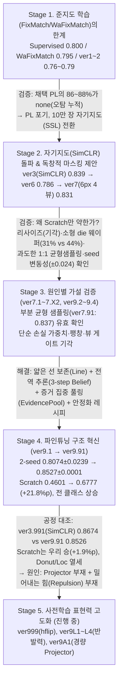

# 웨이퍼빈맵(WM-811K) 결함 탐지 성능 향상 — 문제 해결 중심 실험 기록

> **연구 목표**: 반도체 팹(Fab) 환경을 가정해 **라벨 데이터 5% (6,919장)** 만으로 9종 웨이퍼 결함(특히 최약체 소수 클래스 `Scratch`, `Loc`, `Donut`)을 정확하고 안정적으로 분류하는 것.  
> **공통 환경**: WM-811K `96×96`, `ResNet-18` (ImageNet 사전학습 없음), Unlabeled 100,000장 SSL 사전학습(50 epoch), 평가 지표 **Test Macro F1** 및 **Scratch F1**.

---

## 전체 문제 해결 흐름 요약



---

## Stage 1. 출발점: 준지도 학습(FixMatch / WaFixMatch)의 벽 → 자기지도(SSL)로의 전환

### 1) 무엇을 실험했는가 (`supervised`, `fixmatch`, `wafixmatch`, `ver1`, `ver1.1`, `ver2`)
- 5% 라벨만으로 지도학습(`supervised: 0.8004`)을 넘기 위해 표준 `FixMatch`, 웨이퍼 특화 `WaFixMatch`, 채택률 기반 지도손실 감쇠(`ver1`, `ver1.1`), 국소 특징 패턴 사전(`ver2`)을 순차 구현·실험.
- 결과는 `fixmatch 0.7234`, `wafixmatch 0.7950`, `ver1 0.7883`, `ver1.1 0.7928`, `ver2 0.7557`로 **모두 지도학습 기준선(`0.8004`)을 넘지 못함**.

### 2) 원인을 검증해 본 결과
- **원인 1 (기하 훼손)**: 표준 FixMatch의 `flip+shift`·RandAugment는 웨이퍼의 위치(`Center` vs `Edge-Loc`)를 망가뜨려 성능 급락.
- **원인 2 (Pseudo-label 오탐 누적)**: 채택된 pseudo-label의 **86~88%가 정상(`none`)** 이었고, epoch 4만에 채택률이 0.6에 도달해 아직 미성숙한 모델의 오분류가 학습에 그대로 누적됨.
- **원인 3 (Cutout의 Scratch 파괴)**: 랜덤 cutout은 `Scratch`를 일관되게 악화(`-0.038 ~ -0.163`).

### 3) 어떻게 고쳤는가 (`ver3` ~ `ver3.2`)
- **방향 전환**: 불안정한 Pseudo-label 대신 **10만 장 Unlabeled 데이터로 자기지도 사전학습(SimCLR) 후 5% 라벨만 미세조정**하는 2단계 구조로 전환.
- 초기에는 군집화 pseudo-label(`ver3.1 base: 0.8094`, `ver3.2: 0.8137`)도 붙여봤으나, 군집 오명명(정상 다수 군집이 `Scratch`로 명명됨)이 오히려 해가 됨을 ablation(`--v3_nopl`)으로 입증.
- **결과**: 군집 PL을 제거한 순수 SimCLR + 라벨 미세조정 **`ver3`가 `0.8391` (Scratch `0.6161`)**, 불량비율 필터 포함 `ver3.1 nopl`이 **`0.8475`** 를 기록하며 단숨에 준지도 계열의 벽을 돌파.

---

## Stage 2. 우리만의 사전학습 제안: 디코더 없는 잠재 다중 마스킹 앙상블 (`ver6` → `ver7`)

### 1) 왜 새로운 사전학습을 설계했는가
- `ver3`(SimCLR)는 강한 기하 왜곡(`crop`, `cutout`, `shift`)에 의존해 웨이퍼 결함의 위치·선 연결성을 해칠 수 있고, 기존 WaPIRL 대비 방법론적 독창성이 약함.
- 반면 픽셀 복원(MAE)은 웨이퍼의 90%+인 배경/정상 die 복원에 용량을 낭비.
- **제안 아이디어**: 디코더 없이 **EMA 원본 타겟 `z` vs 마스킹된 4개 뷰 예측 벡터 평균 `mean(p_i)`** 의 잠재 일관성(`1 - cos`) 학습.

### 2) 초기 실패와 원인 진단 (`ver6` → `ver6.1` → `ver6.2/ver7`)
- **`ver6` (`0.7859`, Scratch `0.3622`) 실패**: 43×43 사각 블록(20%) + 회전 없음 + 선형 Predictor로 시작했더니 **12스텝 만에 loss가 0.06으로 급락(문제가 너무 쉬움)** 하고, `z_std ≈ 0.02`로 부분 표현 붕괴 발생.
- **해결 (`ver6.1`: `0.8291` → `ver6.2 / ver7`: `0.8314`)**:
  1. 20% 블록 → **50% 바둑판 마스킹 (`6px`)** 으로 복원 난이도 상승
  2. 원본과 4개 마스킹 뷰에 **서로 다른 무작위 회전** 적용 (회전 불변성 강제)
  3. 선형 Predictor → **2층 MLP Predictor (`512→512→512, BN+ReLU`)**
  - 결과: `0.7859 → 0.8314` (`+4.55%p`) 대폭 반등, `Random(0.902)·Donut(0.872)·Center(0.915)`에서 최고 성능 달성.

### 3) 핵심 설계 요소 검증 (Ablation & 치팅 검사)

| 검증 항목 | 비교 버전 | 결과 (Test Macro / Scratch) | 검증 결론 |
|---|---|---|---|
| 바둑판 칸 크기 | `12px(ver6.1)` / **`6px(ver7)`** / `4px(ver6.5)` | `0.829` / **`0.831`** / `0.819` | **6px 최적** |
| 마스킹 뷰 개수 | **`4뷰(ver7)`** vs `3뷰(ver6.3)` | **`0.831`** vs `0.811` | **4뷰 필수** (합집합이 94% 커버) |
| 마스킹 비율 | **`50%(ver7)`** vs `30%(ver6.4)` | **`0.831`** vs `0.807` | **50% 필수** |
| Predictor 구조 | **`2층 MLP(ver7)`** vs `선형(ver6.6)` | **`0.831 / 0.477`** vs `0.808 / 0.308` | **2층 MLP 필수** |
| 백본 크기 | **`ResNet-18(ver7)`** vs `ResNet-34(ver7.1)` | **`0.831`** vs `0.794` (`ft60: 0.800`) | **ResNet-18 최적** |
| 앙상블 손실 & 치팅 | `mean 후 loss(ver7)` vs `뷰별 loss(ver7.2)` + `leak.py` | `0.831` vs `0.826` (2-seed `0.820`) | **형제 뷰 간 정보 누수(치팅) 없음 확인** |

---

## Stage 3. "왜 `Scratch`만 유독 약하고 seed마다 흔들릴까?" — 가설 5개 정밀 검증 (`ver7.3` ~ `ver7.X2`, `ver9.2` ~ `ver9.4`)

`ver7`은 `Donut/Center/Random`은 강했지만 **`Scratch`가 `0.477`(SimCLR `0.616` 대비 `-14%p`)** 에 머물렀고, `seed 1` 복제 실험에서 `0.831 → 0.783` (`2-seed 0.8074 ± 0.0239`)으로 흔들리는 문제가 드러났습니다. 이를 진단하기 위해 5가지 가설을 하나씩 검증했습니다.

### 가설 1. "96×96 리사이즈 때문에 얇은 `Scratch` 선이 끊어진 것 아닌가?" → **기각**
- **검증 (`scratch_resize.py`)**: Scratch 웨이퍼의 **95%는 원본이 96px보다 작아(중앙값 41×38) 확대(업샘플링)** 되었으며, 모델이 놓친 웨이퍼도 96×96 입력에 선이 또렷하게 남아 있음.
- 얇은 선을 두껍게 해 본 2채널 팽창 입력 **`ver7.3` (5×5 / 3×3 팽창)** 도 `0.799 / 0.803`으로 오히려 악화 → **입력 손실이 아니라 모델이 선 모양을 못 배우는 것**으로 확정.

### 가설 2. "die 수가 적은 소형 웨이퍼에서 바둑판 마스킹이 선을 지워버리는 것 아닌가?" → **부분 확인 + 진짜 원인 특정**
- **검증 (`diesize.py`, `diecell.py`)**:
  - die 수 구간별 Scratch 재현율 분석 결과, **소형 웨이퍼(`<1200 die`, 61장)에서 `ver7` 31% vs `ver3` 44%** 로 격차가 집중되고, 반대로 대형 웨이퍼(`2500+ die`)에서는 `none → Scratch` 오탐이 `ver7 11~23건 vs ver3 3건`으로 과다 발생.
  - 하지만 마스킹 칸 크기(`12/6/4px`)나 비율(`30%`)을 바꿔도 소형 웨이퍼 재현율은 `21~31%`로 동일 → **마스킹 크기 문제가 아니라 스케일 증강(`crop`) 또는 Negative 부재 문제**.
  - 실제로 마스킹 뷰에 `crop`을 넣은 **`ver7.X` (`0.8364`)** 는 소형 웨이퍼 Scratch 재현율을 `31% → 39%`로 끌어올렸으나 대형 웨이퍼 오탐이 늘어 근본 해결엔 미흡.
  - 줄무늬 마스킹 **`ver7.7`** 은 Scratch가 `0.5364`로 상승했으나 커리큘럼(`ver7.X1: 0.8216`)에서 유지되지 못함.

### 가설 3. "사전학습 4뷰를 단순 평균 대신 어텐션/게이트로 똑똑하게 합치면?" → **기각**
- **검증 (`ver9.2` Inter-View SA `0.8296`, `ver9.3` Similarity Gate `0.8148`, `ver9.4` Conditioned Gate `0.8165`)**: 가중치 게이트를 두면 쉬운 뷰 1장에 가중치가 쏠리는 **편식(winner-take-all)** 이 발생해 단순 평균(`ver7`)보다 하락.

### 가설 4. "파인튜닝 손실(Triplet / Focal / 클래스 가중치)로 불균형을 잡으면?" → **손실 조작은 기각, 샘플링 완화는 채택!**
- **검증**:
  - `ver7.4` (Triplet `0.8329`): 정밀도는 올랐지만 재현율 하락으로 소폭 변화.
  - `ver7.5` (Focal `0.8071`): 이미 배치 샘플러가 1:1 균형이라 Focal의 전제가 깨지며 `none → Scratch` 오탐 **155건** 폭증.
  - `ver7.8 ~ 7.83` (`none` 가중치 축소 / `Scratch` 가중치 확대): Recall-Precision 맞교환뿐 순이득 없음 (`0.769 ~ 0.818`).
  - **핵심 발견 (`ver7.91`, `sample_pow=0.5`)**: 완전 1:1 균형 샘플링 대신 **제곱근 비례 부분 균형 샘플링**으로 바꾼 것만으로 `none → defect` 오탐이 **`299 → 143건`으로 절반 이하 감소**, **`Test 0.8371` / `Val 0.822` 최고점** 달성!

### 가설 5. "사전학습 인코더 표현 자체의 분리력은 어떤가?" → **핵심 진단 (`probe.py`)**
- 인코더를 얼린 Frozen Probe에서 **`ver3` SimCLR (`kNN 0.630 / linear 0.677`) vs `ver7` (`0.504 / 0.478`)** 로 큰 격차 확인. 즉, `ver7`은 파인튜닝 단계에 크게 의존하는 상태였고, 고정 LR 파인튜닝의 seed 불안정성(`±0.0239`)이 결과를 더 흔들고 있었음.

---

## Stage 4. 돌파구: 웨이퍼 특화 파인튜닝 아키텍처 & 안정화 레시피 (`ver9.1` → `ver9.91`)

Stage 3의 진단으로 **"입력에는 선이 살아 있는데 ResNet-18 파인튜닝 구조가 이를 지우고 희석하며, 1:1 샘플링과 고정 LR이 오탐·불안정을 키운다"** 는 4가지 구조적 병목이 명확해졌습니다. **`ver7` 인코더(`masklat7_e50.pt`)를 100% 그대로 둔 채** 4가지 병목을 하나씩 해결했습니다.

| 발견된 병목 | 도입한 해결책 | 적용 버전 | 실제 효과 |
|---|---|---|---|
| **① ResNet 초반 stride-2에서 1~2px `Scratch` 선 소실** | **`OrientedLineBranch`**: 96×96 anomaly 맵에 8방향 다중스케일(`9×9`, `15×15`) 선 필터 + 방향성 이방성(`max - mean`) + `MaxPool` 전용 스트림 | `ver9.9` → **`ver9.91`** | `Scratch` 정답 `58.5 → 82.0/120`, 미탐(`S→none`) `-45%` |
| **② 좁은 수용영역으로 끊어진 선·전역 위치 맥락 부족** | **`IterativeSpatialBeliefAttention`**: `layer3(6×6)`에서 2D 상대위치 바이어스 + 9클래스 Belief를 3-step 반복 추론 (`ver9.1/9.5/9.6`으로 `layer3` 최적 위치 먼저 검증) | `ver9.7` → **`ver9.91`** | `S→Loc` 혼동 `-33%`, `Loc +4.8%p`, `Edge-Loc +4.5%p` |
| **③ `layer4(3×3)` `AvgPool`이 1~2칸 소형 결함을 정상 8칸에 희석** | **`SpatialEvidencePooling`**: 0-초기화 Gated Attention 풀링으로 결함 칸에만 집중, 정상 웨이퍼는 균등 평균 유지 | `ver9.7`, `ver9.9B2`, **`ver9.91`** | `ver9.9B→B2`에서 `none→Scratch` 오탐 **`102 → 12건`(-88%)** |
| **④ 1:1 샘플링 오탐 + 5% 라벨 과적합 + 회전만 증강** | **`sample_pow=0.35` + Label Smoothing(0.05) + `attn_wd=0.02` + Warmup/Cosine + `hflip`** | `ver9.7` → **`ver9.91`** | `none→defect` 오탐 절반 이하, **2-seed 편차 `±0.0239 → ±0.0001`** |

### 단계별 성능 도약 및 시너지 검증 결과

| 버전 | 구성 요약 (`ver7` 인코더 고정) | Test Macro F1 | Scratch F1 | 비고 |
|---|---|---:|---:|---|
| `ver7` (레퍼런스) | 기본 ResNet-18 + AvgPool + 1:1 샘플링 | `0.8074 ± 0.0239` *(2-seed)* | `0.4601` | 기준선 |
| `ver9.1 / 9.5 / 9.6` | 단순 Spatial SA 위치 비교 (`layer4` / `3` / `2`) | `0.825` / `0.829` / `0.818` | `0.472` / `0.496` / `0.474` | `layer3` 최적 확정 |
| `ver9.7` | `3-step Belief + EvidencePool + 레시피` | `0.8395 ± 0.0016` *(2-seed)* | `0.5484` | `a0~a5` 6종 ablation으로 전 요소 기여 입증 |
| `ver9.8` | `ver9.7` + `layer2(12×12)` RelSpatialAttention | `0.8331 ± 0.0074` *(2-seed)* | `0.4688` | 기각 (`layer2` 과적합) |
| `ver9.9A` / `9.9B` | `Line+pow` / `Line+Belief` (최소 조합 탐색) | `0.8285` / `0.8351` *(seed 0)* | `0.4809` / `0.5477` | 단독 캐리 없음 확인 |
| **`ver9.9B2`** | **`Line + 3-step Belief + EvidencePool` (순정 학습 100%)** | **`0.8479`** *(seed 0)* | **`0.6569`** | **순수 구조 3각 시너지 입증** |
| **`ver9.91`** | **`ver9.9B2` + 레시피(`pow=0.35`, LS/WD/Cos, `hflip`)** | **`0.8527 ± 0.0001`** *(2-seed)* | **`0.6777 ± 0.0000`** | **전 9개 클래스 동반 상승 (`+4.53%p`)** |

---

## Stage 5. 최종 관문: "우리 마스킹 사전학습이 정말 SimCLR을 이기는가?" (`ver3.991` vs `ver9.91` → `ver9L1~A1`)

### 1) 공정 대조 실험에서 드러난 새로운 문제 (`ver3.991` vs `ver9.91`, `seed 0`)
같은 `ver9.91` 파인튜닝을 SimCLR 인코더(`ver3.991`)와 우리 `ver7` 인코더(`ver9.91`)에 동일하게 붙여 비교한 결과:
- **`Scratch`**: **우리 마스킹(`0.6777`) > SimCLR(`0.6585`) (`+1.92%p` 우리 승!)** → 바둑판 마스킹의 얇은 선 보존 강점 입증.
- **전체 Macro F1**: 우리(`0.8526`) < SimCLR(`0.8674`) (`-1.48%p`).
- **격차 발생 클래스**: `Donut (-5.97%p)`, `Near-full (-3.69%p)`, `Loc (-2.72%p)`, `Center (-1.95%p)`.

### 2) 원인 진단
1. **밀어내는 힘(Repulsion) 부재**: `ver7`은 같은 웨이퍼만 당기는(`1 - cos`) 구조라, 85%가 정상(`none`)인 데이터에서 비슷하게 생긴 덩어리 결함(`Donut` ↔ `Center` ↔ `Loc`)을 임베딩 공간에서 충분히 떼어놓지 못함.
2. **Projector(표현 보호 방패) 부재**: `ver3`(SimCLR)에는 `Projector(512→512→128)`가 있어 불변성 압력을 흡수한 뒤 버리지만, `ver7`은 인코더 512차원 출력에 직접 손실을 걸어 세밀한 변별 정보가 손실됨.
   - 실제로 방패·반발력 없이 사전학습에 `hflip`만 추가한 **`ver999`** 는 `z_std`가 `0.0296 → 0.0256`으로 줄며 `0.8099`로 오히려 하락.

### 3) 현재 진행 중인 통제 검증 (파라미터 동결·축소 조건, `seed 0`, 순정 파인튜닝)

| 버전 | `ver7` 대비 단일 변경점 | 사전학습 헤드 파라미터 | Test Macro F1 | Scratch | Donut | 상태 |
|---|---|---:|---:|---:|---:|---|
| `ver3` (SimCLR) | 대조학습 기준선 (`Projector` 포함) | `328K` | `0.8391` | `0.6161` | `0.8214` | 완료 |
| `ver7` (레퍼런스) | 6px 4뷰 바둑판 + `rotate` + `1 - cos` | `526K` | `0.8314` | `0.4766` | `0.8718` | 완료 |
| `ver999` | 사전학습 `hflip` 추가 | `526K` | `0.8099` | `0.4232` | `0.8522` | 완료 |
| `ver9L1` | **L1**: Masked InfoNCE (`tau=0.2`, EMA 유지) | `526K` | `0.8168` | `0.4281` | `0.8448` | 완료 (Projector 없는 InfoNCE 한계 확인) |
| `ver9L2` | **L2**: `1 - cos` + Uniformity 반발력 (`0.1`) | `526K` | `0.8240` | `0.4412` | `0.8624` | 완료 |
| `ver9L3` | **L3**: `1 - cos` + VICReg (`Var + Cov`) | `526K` | *(진행 중)* | - | - | 실행 중 |
| `ver9L4` | **L4**: Debiased Masked InfoNCE | `526K` | *(대기)* | - | - | 대기 |
| `ver9A1` | **A1**: 경량 `Projector(512→256→128) + Predictor` | **`231K`** *(절반 이하)* | *(대기)* | - | - | 대기 |

---

## 재현 방법

```bash
# 1. 데이터 캐시 생성 (최초 1회)
python wafixmatch.py prepare

# 2. 주요 단계별 재현
python wafixmatch.py run --frac 0.05 --method ver3 --seed 0      # SimCLR 기준선
python wafixmatch.py run --frac 0.05 --method ver7 --seed 0      # 우리 마스킹 레퍼런스
python wafixmatch.py run --frac 0.05 --method ver9.91 --seed 0   # 파인튜닝 구조 혁신 (최고 성능)
python wafixmatch.py run --frac 0.05 --method ver9.9B2 --seed 0  # 순수 구조 3각 시너지 최소 조합

# 3. 전체 결과 요약
python wafixmatch.py summary
```
