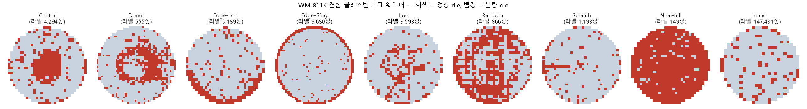
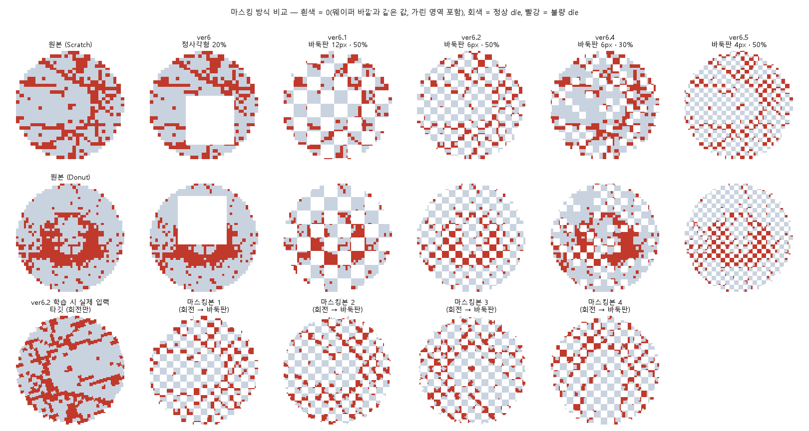

# wafer-defect

**WM-811K 웨이퍼빈맵(Wafer Bin Map) 결함 탐지 성능 향상 연구**

반도체 팹(Fab)의 소량 라벨 환경(**Labeled 5%, 6,919장**)에서 9종 웨이퍼 결함(특히 얇은 선형 소수 결함 `Scratch` 및 국소 결함 `Loc`, `Donut`)을 정확하고 안정적으로 분류하기 위한 **자기지도 사전학습(SSL)** 및 **웨이퍼 특화 파인튜닝 아키텍처** 개선 프로젝트입니다.

> **문서 바로가기**
> - **전체 실험 스토리 (문제 발견 → 원인 검증 → 해결책 → 결과)**: [EXPERIMENTS.md](EXPERIMENTS.md)
> - **프로젝트 로드맵 & 진행 체크리스트 (Phase 1~6)**: [ROADMAP.md](ROADMAP.md)

---

## 핵심 성과 요약

- **데이터셋**: WM-811K (`96×96`, 9-class, Labeled 5% = 6,919장 / Unlabeled SSL 100,000장 / Val 17,295장 / Test 17,296장)
- **백본**: `ResNet-18` (ImageNet 사전학습 미사용, From-scratch)

| 단계 / 모델 | 설명 | Test Macro F1 | Scratch F1 | 비고 |
|---|---|---:|---:|---|
| `supervised` | 5% 라벨 지도학습 기준선 | `0.8004` | `0.4388` | seed 0 |
| `wafixmatch` | 웨이퍼 특화 FixMatch 재현 | `0.7950` | `0.4646` | seed 0 |
| `ver3` (SimCLR) | 10만 장 SimCLR + 라벨 미세조정 | `0.8391` | `0.6161` | SSL 기준선 (seed 0) |
| **`ver7` (레퍼런스)** | **디코더 없는 6px 4뷰 바둑판 잠재 마스킹 SSL** | `0.8074 ± 0.0239` | `0.4601` | 2-seed 평균 (`seed0: 0.8314`) |
| **`ver9.9B2`** | `ver7` 인코더 + 순수 구조 3종 (`Line + Belief + Pool`) | `0.8479` | `0.6569` | 순정 학습 그대로 `+1.65%p` |
| **`ver9.91`** | **`ver7` 인코더 + 구조 3종 + 안정화 레시피** | **`0.8527 ± 0.0001`** | **`0.6777 ± 0.0000`** | **2-seed 평균, 전 9개 클래스 상승** |
| `ver3.991` *(대조군)* | SimCLR 인코더 + `ver9.91` 파인튜닝 | `0.8674` | `0.6585` | `Scratch`는 `ver9.91` 우위 (`+1.92%p`) |



---

## 핵심 방법론

### 1. 사전학습 — Latent Multi-Masking Ensemble Consistency (`ver7`)
- **동기**: 픽셀 복원(MAE)은 웨이퍼의 90%+인 배경/정상 die 복원에 용량을 낭비하고, SimCLR의 `crop/cutout/shift`는 웨이퍼 결함의 위치(`Center`/`Edge-Loc`)와 선 연결성(`Scratch`)을 왜곡할 수 있음.
- **구조**: 디코더 없이 **EMA 원본 타겟 `z`** 와 **6px 50% 바둑판 마스킹 + 독립 회전이 적용된 4개 뷰 예측 평균 `mean(p_i)`** 간의 잠재 공간 일관성 학습.
- **사전학습 고도화 (Stage 5)**: `ver9L1~L4` (InfoNCE / Uniformity / VICReg / Debiased InfoNCE), `ver9A1` (경량 `Projector + Predictor`, 헤드 `526K → 231K`)로 `Donut / Center / Loc` 분리력 강화 검증 중.



### 2. 파인튜닝 — 웨이퍼 특화 3모듈 + 안정화 레시피 (`ver9.91`)
- **`OrientedLineBranch`** (`wafer/models.py`): 원본 `96×96` anomaly 맵에 8방향 다중 스케일(`9×9`, `15×15`) 선형 필터 + 방향성 이방성(`max - mean`) + `MaxPool`만 사용해 1~2px `Scratch` 선 소실 방지.
- **`IterativeSpatialBeliefAttention`** (3-step, `layer3`): `6×6` 공간 토큰에 2D 상대위치 바이어스 + 9클래스 Belief를 3회 반복 추론해 끊어진 선과 위치 맥락 파악.
- **`SpatialEvidencePooling`**: 0-초기화 Gated Attention 풀링으로 `layer4(3×3)`에서 결함 칸에 집중하고 정상 웨이퍼에서는 균등 평균 유지 (`none → Scratch` 오탐 88% 감소).
- **안정화 레시피**: 부분 균형 샘플링(`sample_pow=0.35`), `Label Smoothing(0.05)`, `attn_wd=0.02`, `5 epoch Warmup + Cosine LR`, `hflip`($O(2)$ 대칭)으로 2-seed 편차를 `±0.0239 → ±0.0001`로 안정화.

---

## 프로젝트 구조

```text
wafer-defect/
├── README.md                # 프로젝트 개요 및 실행 가이드
├── EXPERIMENTS.md           # Stage 1~5 문제 해결 과정 및 전체 실험 결과표
├── ROADMAP.md               # Phase 1~6 프로젝트 로드맵 및 마일스톤 체크리스트
├── requirements.txt         # Python 의존성
├── wafixmatch.py            # 통합 실행 CLI (prepare / run / summary)
├── wafer/
│   ├── data.py              # WM-811K 96x96 패킹 캐시 로더 및 데이터 분할
│   ├── augment.py           # GPU 배치 증강 (회전, 좌우반전, 바둑판/줄무늬 마스킹)
│   ├── models.py            # ResNet + OrientedLineBranch, IterativeSpatialBeliefAttention, SpatialEvidencePooling
│   ├── selfsup.py           # SimCLR(ver3) 사전학습 및 파인튜닝 파이프라인
│   ├── ver6.py              # Latent Multi-Masking Ensemble Consistency (ver6~ver9L/A)
│   ├── engine.py            # 학습 루프, BalancedSampler, 평가 지표
│   └── patterns.py          # ver2 패턴 사전
├── analysis/                # 원인 진단 스크립트 (frozen probe, die 크기 분석, 리사이즈/치팅 검증)
└── results/                 # 클래스 예시, 마스킹 시각화, 혼동행렬 이미지
```

---

## 빠른 시작

### 1. 환경 설치
```bash
pip install -r requirements.txt
```
*(CUDA 환경에 맞는 PyTorch 설치 권장, 원본 `LSWMD.pkl`은 Kaggle WM-811K에서 다운로드 후 프로젝트 루트에 배치)*

### 2. 데이터 캐시 생성 (최초 1회)
```bash
python wafixmatch.py prepare --cache ./wafer_cache
```

### 3. 실험 실행 및 결과 요약
```bash
# 기준선 및 주요 모델 실행
python wafixmatch.py run --frac 0.05 --method ver3 --seed 0 --cache ./wafer_cache
python wafixmatch.py run --frac 0.05 --method ver7 --seed 0 --cache ./wafer_cache
python wafixmatch.py run --frac 0.05 --method ver9.91 --seed 0 --cache ./wafer_cache
python wafixmatch.py run --frac 0.05 --method ver9.9B2 --seed 0 --cache ./wafer_cache

# 전체 결과표 출력
python wafixmatch.py summary
```
