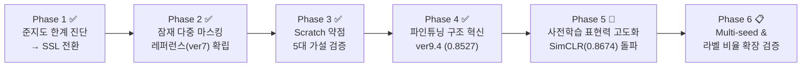

# Project Roadmap — WM-811K 웨이퍼빈맵 결함 탐지

> **최종 목표**: 5% 소량 라벨 환경에서 **우리의 잠재 다중 마스킹 사전학습 + 웨이퍼 특화 파인튜닝(`ver9.4`)** 조합으로 `SimCLR` 기준선(`ver9.4_simclr: 0.8674`)을 **전체 Macro F1과 최약체 `Scratch` 모두에서 확실하게 상회**하고, 다중 시드·다양한 라벨 비율에서 재현성을 입증하는 것.

---

## 전체 로드맵 흐름

---

## 마일스톤별 진행 현황

| Phase | 목표 | 핵심 지표 / 산출물 | 상태 |
|---|---|---|---|
| **Phase 1** | 준지도(FixMatch) 한계 규명 및 SSL 전환 | `WaFixMatch 0.795` → `ver3 SimCLR 0.8391` | ✅ 완료 |
| **Phase 2** | 디코더 없는 잠재 다중 마스킹(`ver7`) 설계 | `ver6 0.786` → `ver7 0.8314` (6px 4뷰 바둑판) | ✅ 완료 |
| **Phase 3** | `Scratch` 취약 원인 및 seed 불안정성 진단 | `diesize`, `probe`, `ver7.91(0.8371)` | ✅ 완료 |
| **Phase 4** | 웨이퍼 특화 파인튜닝 아키텍처 완성 | **`ver9.4` 2-seed `0.8527 ± 0.0001` / Scratch `0.6777`** | ✅ 완료 |
| **Phase 5** | 사전학습 반발력·Projector 도입으로 SimCLR 돌파 | `ver9.5B~E`, `ver9.5F` → 최종 결합 체크포인트 (`> 0.8674`) | 🔄 진행 중 |
| **Phase 6** | 최종 Ablation, Multi-seed, 라벨 비율 확장 | `Line+Pool` 검증, `seed 0/1/2`, `frac 1%/5%/10%` | 📋 예정 |

---

## 상세 체크리스트

### Phase 1. 베이스라인 구축 및 준지도 한계 진단 ✅
- [x] `Supervised(5%)`, `FixMatch`, `WaFixMatch` 재현 및 오분류 분석
- [x] 손실 감쇠(`ver1`, `ver1.1`), 패턴 사전(`ver2`) 검증 → pseudo-label 86~88% `none` 쏠림 확인
- [x] 10만 장 자기지도 학습(`ver3` SimCLR: `0.8391`)으로 방향 전환 및 군집 PL 역효과 확인(`--v3_nopl`)

### Phase 2. 독창적 잠재 다중 마스킹 사전학습(`ver7`) 확립 ✅
- [x] `ver6` (`0.7859`) 초기 붕괴 진단 → `ver6.1` → **`ver6.2/ver7` (`0.8314`)** 설계
- [x] 핵심 요소 Ablation 완료: 칸 크기(`12/6/4px`), 뷰 수(`3/4`), 비율(`30%/50%`), MLP Predictor, 백본(`R18/R34`)
- [x] 형제 뷰 간 정보 누수(치팅) 없음 검증 (`analysis/leak.py`)

### Phase 3. `Scratch` 취약 원인 정밀 진단 ✅
- [x] 96×96 리사이즈 손실 가설 검증 → 기각 (`analysis/scratch_resize.py`, `ver7.3`)
- [x] die 수 구간별 재현율 분석 → 소형 웨이퍼(`<1200 die`) 약점 특정 (`analysis/diesize.py`, `diecell.py`)
- [x] 뷰 게이트/어텐션(`ver9.2A~C`), 손실 가중치(`ver7.4~7.83`) 검증 → **부분 균형 샘플링(`ver7.91: 0.8371`)** 유효 확인
- [x] Frozen Probe(`analysis/probe.py`) 및 `seed 1` 복제로 사전학습 분리력·고정 LR 불안정성(`±0.0239`) 확인

### Phase 4. 파인튜닝 아키텍처 혁신 (`ver9.1` → `ver9.4`) ✅
- [x] 어텐션 최적 위치 탐색 (`ver9.1A/B/C`: `layer4/3/2` → `layer3 6×6` 확정)
- [x] **`ver9.3`** (`IterativeSpatialBeliefAttention` 3-step + `SpatialEvidencePooling` + 안정화 레시피): 2-seed `0.8395 ± 0.0016` + 6종 leave-one-out ablation (`a0~a5`)
- [x] **`ver9.4`** (`+ OrientedLineBranch` + `hflip`): 2-seed **`0.8527 ± 0.0001`**, Scratch **`0.6777 ± 0.0000`**, 전 9개 클래스 동반 상승
- [x] Forward Ablation (`ver9.4A`, `ver9.4B~B4`): `ver9.4B2` (`0.8479`, 순정 학습 100%)로 구조 시너지 입증

### Phase 5. 사전학습 표현력 고도화 — SimCLR(`0.8674`) 돌파 🔄
- [x] 공정 대조 실험 (`ver9.4_simclr` SimCLR `0.8674` vs `ver9.4` `0.8526`): **`Scratch` 우리 우위(`+1.92%p`)**, `Donut/Loc/Center` 열세 원인(Projector·반발력 부재) 특정
- [x] 단일 변경 통제 실험 1차 완료: `ver9.5A` (`hflip`: `0.8099`), `ver9.5B` (Masked InfoNCE: `0.8168`), `ver9.5C` (Uniformity: `0.8240`)
- [x] 단일 변경 통제 실험 2차 완료: `ver9.5D` (VICReg: `0.8175`), `ver9.5E` (Debiased InfoNCE: `0.8115`, Scratch `0.4878`), `ver9.5F` (경량 Projector `231K`: `0.8165`, Loc `0.7275`)
- [x] 반발력 + Projector 결합 실험 완료 (`ver9.6A_B2`: Test `0.8525` / Val `0.8387`, `ver9.6B_B2`: Test `0.8379` / Scratch TP `89/120`, `ver3_B2`: Test `0.8640`)
- [x] **`Line` 필터 4종 최적화 완료 (`ver9.7A~D` 순정 & `_B2`)**: 학습형 커널 **`ver9.7B_B2` (Test `0.8598`, Val `0.8427`)**, 다이 크기 보간 **`ver9.7C_B2` (Scratch F1 `0.6891` 역대 1위)**, AvgPool 피라미드 **`ver9.7D_B2` (Scratch `0.6639`)** 달성!
- [ ] **`Belief` (3-step 어텐션) 최적화** 및 `Line` 승자 조합 → **`ver9.4_simclr` / `ver3_B2` (`0.864~0.867`) 정면 돌파 확인**
- [ ] 마스킹 대신 노이즈 복원 SSL(`k10.1`)로 `none→Scratch` 오탐(`58~63건 → ≤24건`) 해소

### Phase 6. 최종 검증 및 리포트 완성 📋
- [x] 남은 구조 ablation 1종 완료: **`ver9.4C` (`Line + Pool`, `Belief` 제거: `0.8274`, Scratch `0.5263`)** + **`ver9.4B2` 2-seed 검증 (`0.8468 ± 0.0011`)** → 3각 시너지 최종 확정!
- [ ] 최종 승자 모델 **Multi-seed (`seed 0, 1, 2`)** 평균·표준편차 보고
- [ ] **라벨 비율 확장 실험 (`frac = 1%, 5%, 10%`)**: 극소량 라벨 환경에서의 강건성 입증
- [ ] 최종 혼동행렬·클래스별 비교표·아키텍처 도식화 완성 및 최종 리포트 정리
