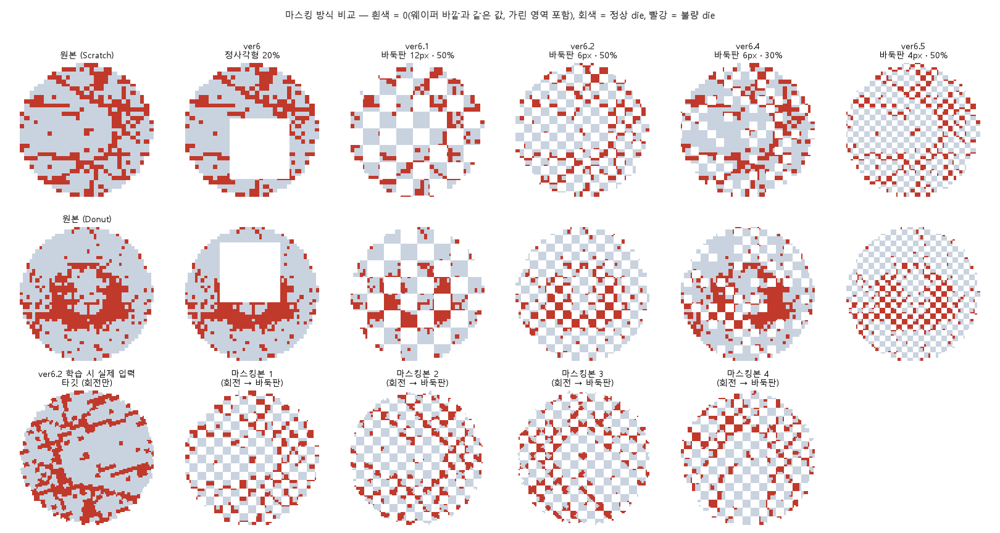

# ver6 계열 실험 보고서: 잠재 공간 멀티 마스킹 자기지도 학습

WM-811K 웨이퍼 빈맵 결함 분류 · 5% 라벨 · 2026-10-29 ~ 2026-11-02

## 1. 요약

- **목적**: 자기지도 사전학습을 SimCLR(대조학습) 대신 **"마스킹한 웨이퍼 여러 장의 평균 특징 벡터가 원본 특징 벡터와 같아지도록"** 학습하는 방식(디코더 없이 1차원 잠재 벡터 연산만)으로 바꿔, 기준선 ver3(일반 SimCLR, macro-F1 0.839)를 넘는지 확인.
- **결과**: 단일 모델로는 기준선을 넘지 못함. 최고 설정은 **ver6.2(6px 바둑판 50%) 0.831**.
- **강점과 약점이 뚜렷하게 갈림**: 마스킹 방식은 Random·Donut·Center처럼 **전체 분포·모양이 중요한 패턴**에서 SimCLR보다 강하고(Random 0.902, Donut 0.872), Scratch처럼 **가는 연속 구조**에서 약함(0.45~0.52 vs SimCLR 0.616).
- **두 모델 조합(ver3 + ver6.2)**: 추가 학습 없이 클래스별 가중치로 섞으면 **macro-F1 0.857**로 지금까지 최고. 논문 보고값 WaFixMatch(0.841)보다 높음. 단, 모델 2개를 쓰는 앙상블이라 대조 실험이 더 필요.

## 2. 실험 설정 (모든 버전 공통)

| 항목 | 내용 |
|---|---|
| 데이터 | WM-811K, 96×96, 라벨 5% (6,919장) + unlabeled 638,507장 |
| 평가 | test macro-F1 (val macro-F1이 가장 높은 epoch 기준), seed 0 단일 실행 |
| 백본 | ResNet-18 (1채널 입력, 특징 512차원) |
| 사전학습 데이터 | unlabeled 중 무작위 10만 장 (기준선 ver3와 동일한 10만 장) |
| 사전학습 | AdamW lr 1e-3, cosine 감쇠, 배치 256, 50 epoch |
| 미세조정 | ver3와 동일: labeled만, 클래스 균형 추출, 회전 증강, AdamW lr 1e-3 고정, 90 epoch |
| 비교 기준 | **ver3** = 같은 데이터·같은 미세조정에 사전학습만 SimCLR (macro-F1 0.839) |

비교를 깔끔하게 하기 위해 **사전학습 방식 외의 모든 조건을 ver3와 같게** 맞췄다.

## 3. 방법: Latent Multi-Masking Ensemble Consistency

```
원본 웨이퍼 ──(회전)──▶ 타깃 인코더 (EMA, gradient 멈춤) ──▶ 원본 벡터 z
                                                                  │
마스킹본 ×4 ──(각자 회전 → 마스킹)──▶ 온라인 인코더 ──▶ Predictor ──▶ 예측 벡터 4개 ──▶ 평균 p
                                                                  │
                                        손실 = 1 − cos(p, z)  ◀───┘
```

- **디코더 없음**: 픽셀을 복원하지 않고, 512차원 특징 벡터끼리의 cosine 유사도만 맞춘다.
- **붕괴 방지**: 원본 벡터는 학습 중인 인코더를 천천히 따라오는 **EMA 타깃 인코더**(0.996)로 뽑고, 그쪽으로는 **gradient를 보내지 않는다** (BYOL 방식).
- **붕괴 감시 지표 z_std**: 정규화한 원본 벡터들의 차원별 표준편차. 건강하면 약 0.044(=1/√512), 붕괴하면 0에 가까워진다.
- **사전학습 특징 품질 NMI**: 사전학습 직후 특징을 군집화했을 때 실제 클래스와 얼마나 일치하는지 (높을수록 좋음).



*그림. 흰색 = 0(웨이퍼 바깥과 같은 값, 가린 영역 포함), 회색 = 정상 die, 빨강 = 불량 die. 3행은 ver6.2 학습 때 웨이퍼 한 장에서 만들어지는 실제 입력 5장.*

## 4. 실험 과정

| 버전 | 바꾼 것 (직전 버전 대비) | 마스킹 | 회전 | Predictor | 마스킹본 수 | 바꾼 이유 |
|---|---|---|---|---|---|---|
| **ver6** | 처음 설계 | 정사각형 1개, 20% | **회전 없음** (원본 그대로) | 선형 (512→512) | 4 | – |
| **ver6.1** | 마스킹·회전·Predictor | **바둑판 12px, 50%** | **각자 다른 무작위 회전** | **2층 MLP** (512→512→512, BN+ReLU) | 4 | ver6의 과제가 너무 쉽고(손실 0.01 안팎) 회전 불변성을 못 배움, 부분 붕괴 |
| **ver6.2** | 칸 크기 | 바둑판 **6px**, 50% | 각자 다른 회전 | 2층 MLP | 4 | 칸을 줄이면 가는 Scratch 선이 덜 지워질 것이라는 가설 |
| **ver6.3** | 마스킹본 수 | 바둑판 6px, 50% | 각자 다른 회전 | 2층 MLP | **3** | 마스킹본 수의 영향 확인 |
| **ver6.4** | 가리는 비율 | 바둑판 6px, **30%** (가릴 칸 중 60%만 가림) | 각자 다른 회전 | 2층 MLP | 4 | 덜 가리면 Scratch 선이 살아남을 것이라는 가설 |
| **ver6.5** | 칸 크기 | 바둑판 **4px**, 50% | 각자 다른 회전 | 2층 MLP | 4 | 칸을 더 줄이면(12 → 6 → 4px) 추세가 어떻게 되는지 확인 |
| **ver6.6** | Predictor | 바둑판 6px, 50% | 각자 다른 회전 | **선형** (512→512) | 4 | ver6 → ver6.1에서 함께 바꾼 세 가지 중 MLP Predictor의 기여 확인 |

사전학습 시간은 버전별로 약 3.3~4.3시간 (RTX 3050 노트북 4GB, 발열에 따라 epoch당 207~314초). ver6.5만 epoch당 약 466초로 약 6.4시간 걸렸다.

## 5. 결과

### 5.1 전체 성능

| 방법 | macro-F1 | 소수 클래스 평균 F1 | 사전학습 NMI | z_std (건강 ≈ 0.044) |
|---|---|---|---|---|
| WaFixMatch (논문 보고값) | 0.841 | – | – | – |
| WaFixMatch (우리 재현) | 0.795 | 0.714 | – | – |
| Supervised (labeled만) | 0.800 | 0.724 | – | – |
| **ver3 (SimCLR, 기준선)** | **0.839** | **0.798** | **0.154** | – |
| ver6 | 0.786 | 0.697 | 0.054 | 약 0.020 |
| ver6.1 | 0.829 | 0.772 | 0.072 | 약 0.024 |
| **ver6.2** | **0.831** | 0.775 | 0.111 | 약 0.025 |
| ver6.3 | 0.811 | 0.755 | 0.111 | 약 0.026 |
| ver6.4 | 0.807 | 0.730 | 0.100 | 약 0.026 |
| ver6.5 | 0.819 | 0.747 | 0.119 | 약 0.026 |
| ver6.6 | 0.808 | 0.734 | 0.085 | 약 0.033 |

소수 클래스 = Near-full, Donut, Random, Scratch, Loc.

### 5.2 클래스별 test F1

| 클래스 | ver3 | ver6 | ver6.1 | ver6.2 | ver6.3 | ver6.4 | ver6.5 | ver6.6 |
|---|---|---|---|---|---|---|---|---|
| Center | 0.884 | 0.906 | 0.897 | 0.915 | 0.869 | 0.917 | **0.922** | 0.907 |
| Donut | 0.821 | 0.821 | 0.843 | **0.872** | 0.836 | 0.720 | 0.808 | 0.833 |
| Edge-Loc | 0.755 | 0.739 | 0.763 | 0.750 | 0.727 | 0.754 | **0.798** | 0.765 |
| Edge-Ring | 0.940 | **0.962** | 0.954 | 0.956 | 0.947 | 0.958 | 0.929 | 0.942 |
| Loc | **0.735** | 0.647 | 0.723 | 0.731 | **0.735** | 0.688 | 0.731 | 0.695 |
| Random | 0.883 | 0.786 | 0.847 | **0.902** | 0.884 | 0.885 | 0.864 | 0.871 |
| Scratch | **0.616** | 0.362 | 0.521 | 0.477 | 0.455 | 0.448 | 0.437 | 0.308 |
| Near-full | 0.933 | 0.867 | 0.929 | 0.897 | 0.867 | 0.909 | 0.897 | **0.966** |
| none | 0.984 | 0.984 | **0.986** | 0.984 | 0.981 | 0.985 | 0.984 | 0.981 |

### 5.3 버전별 해석

- **ver6 → ver6.1 (+0.043)**: 바둑판 50%, 서로 다른 회전, MLP Predictor를 함께 적용해 크게 회복. 특히 Scratch(+0.159)와 Loc(+0.076)이 올라 **회전을 다르게 주는 것이 중요했던 것**으로 보인다. 세 가지를 동시에 바꿔 각각의 기여는 분리되지 않음.
- **ver6.1 → ver6.2 (+0.002)**: 칸 크기를 줄여도 전체 성능은 같음. Random(0.902), Donut(0.872), Center(0.915)는 모든 방법 중 최고 수준이지만 **Scratch는 오히려 하락**(0.521 → 0.477).
- **ver6.2 → ver6.3 (−0.020)**: 마스킹본을 3장으로 줄이면 성능 하락. 사전학습만 약 20% 빨라짐.
- **ver6.2 → ver6.4 (−0.024)**: 덜 가리면 과제가 쉬워져 Donut이 크게 하락(0.872 → 0.720). **Scratch도 개선되지 않음**(0.448).
- **ver6.2 → ver6.5 (−0.012)**: 칸을 4px로 더 줄이면 Center(0.922)·Edge-Loc(0.798)은 올랐지만 Donut(0.808)·Random(0.864)이 떨어짐. **Scratch는 칸이 작아질수록 계속 하락**(12px 0.521 → 6px 0.477 → 4px 0.437). 칸 크기는 6px가 가장 균형이 좋았다.
- **ver6.2 → ver6.6 (−0.023)**: Predictor를 선형으로 되돌리면 성능 하락. 특히 **Scratch가 0.477 → 0.308로 크게 떨어짐**(Near-full 0.966 상승은 test 30장 남짓이라 잡음 가능성 큼). 흥미롭게도 z_std는 0.025 → 0.033으로 오히려 **덜 붕괴**했지만 특징 품질(NMI 0.111 → 0.085)과 최종 성능은 낮았다. **MLP Predictor는 성능에 실제로 도움이 되며**, 그 효과는 붕괴 방지보다는 특징 품질 쪽으로 보인다.
- **부분 붕괴**: 모든 버전에서 z_std가 건강 기준의 절반 수준으로 유지됨. 완전 붕괴는 아니지만 표현의 다양성이 부족하고, 사전학습 특징 품질(NMI)도 SimCLR보다 낮다.

## 6. 추가 분석

### 6.1 두 모델 조합 (추가 학습 없음)

ver3(SimCLR)와 ver6.2(마스킹)의 클래스 확률을 클래스별 가중치로 섞음: score_c = w_c · p(ver6.2)_c + (1 − w_c) · p(ver3)_c

| 조합 방식 | val macro | test macro | 소수 클래스 평균 | Scratch | Random | Donut |
|---|---|---|---|---|---|---|
| ver3 단독 | 0.820 | 0.839 | 0.798 | 0.616 | 0.883 | 0.821 |
| ver6.2 단독 | 0.818 | 0.831 | 0.775 | 0.477 | 0.902 | 0.872 |
| 단순 평균 (w = 0.5) | 0.837 | 0.846 | 0.794 | 0.569 | 0.899 | 0.889 |
| 규칙: Random·Donut·Center만 ver6.2 | 0.826 | 0.842 | 0.795 | 0.616 | 0.888 | 0.872 |
| **val로 고른 클래스별 가중치** | **0.848** | **0.857** | **0.815** | 0.594 | 0.911 | 0.879 |

- val로 고른 ver6.2 가중치: Edge-Loc 1.0 · Center·Donut 0.75 · Loc·Random·Scratch 0.5 · Edge-Ring·none 0.25 · Near-full 0.0
- 가중치는 val에서만 골랐고, test는 최종 평가에만 사용했다.
- **주의**: 모델 2개를 쓰는 앙상블이라 계산량이 2배. 향상이 "두 방식의 강점이 달라서"인지 "모델 2개를 섞어서"인지 구분하려면 **ver3 × 2개(seed만 다름) 앙상블**과 비교해야 한다 (미실행).

### 6.2 Scratch가 약한 원인 분석

test Scratch 120장의 혼동 행렬:

| 모델 | 재현율 | 정밀도 | 놓친 Scratch의 예측 | Scratch로 잘못 예측된 것 |
|---|---|---|---|---|
| WaFixMatch | 0.38 | 0.59 | none 47, Loc 16, Edge-Loc 7 | none 24, Loc 4 |
| ver3 | **0.57** | **0.66** | none 30, Loc 15, Edge-Loc 4 | none 19, Loc 12 |
| ver6.2 | 0.47 | 0.49 | none 41, Loc 19 | none 44, Loc 11 |

- **리사이즈 가설은 기각**: Scratch 웨이퍼의 95%는 원본이 96보다 작아(중앙값 41×38) 확대되며, 선의 연결 상태가 변하지 않는다. ver3가 놓친 51장도 모두 확대된 웨이퍼였다.
- **주된 원인**: 선이 'none' 웨이퍼의 랜덤 불량 속에 묻힘(불량 비율 중앙값 Scratch 0.09 vs none 0.10), 짧은 선이 Loc과 비슷함, labeled Scratch가 48장뿐임.
- **마스킹 방식이 특히 약한 이유 (추정)**: 바둑판 마스킹은 이어진 선을 **짧은 토막으로 끊는다**(위 그림 3행). 칸 크기(12/6/4px), 마스킹본 수(4/3장), 가리는 비율(50/30%)을 바꿔도 Scratch가 0.44~0.52에 머물렀고 칸이 작을수록 오히려 낮아져, 지우는 양보다 **연속성이 끊기는 것** 자체가 문제로 보인다.

## 7. 결론

1. 잠재 공간 멀티 마스킹 자기지도 학습은 단일 모델로는 SimCLR 기준선(0.839)을 넘지 못했다 (최고 ver6.2 0.831).
2. 회전을 각자 다르게 주는 것, 50% 수준으로 충분히 가리는 것, 마스킹본 4장이 성능에 중요했다. 바둑판 칸 크기는 6px가 가장 좋았다 (12px 0.829, 6px 0.831, 4px 0.819).
3. 마스킹 방식과 SimCLR은 **잘 잡는 결함 패턴이 다르다**. 마스킹은 전체 분포·모양(Random, Donut, Center), SimCLR은 가는 연속 구조(Scratch)와 Near-full에 강하다.
4. 이 상보성을 이용한 두 모델 조합이 macro-F1 **0.857**로 가장 높았다.

## 8. 한계와 다음 단계

**한계**
- 모든 결과가 seed 0 단일 실행이다. 클래스별로 ±0.03~0.05, macro-F1로 ±0.01~0.02 정도는 잡음일 수 있다.
- ver6 → ver6.1에서 세 가지를 동시에 바꿔, 각각의 기여는 분리되지 않았다.
- 부분 붕괴(z_std ≈ 건강 기준의 절반)가 해결되지 않았다.

**다음 단계 후보**
- **ver3 × 2개 앙상블 대조 실험** (약 2.5시간): 조합 효과가 상보성 때문인지 검증
- **SimCLR + 마스킹 consistency 동시 학습** (약 4~5시간): 모델 하나로 두 강점을 얻는 방향
- **부분 붕괴 완화**: 특징 분산 정규화(VICReg 방식) 추가

## 부록: 재현 명령

```
python wafixmatch.py run --frac 0.05 --method ver3      # 기준선 (SimCLR)
python wafixmatch.py run --frac 0.05 --method ver6
python wafixmatch.py run --frac 0.05 --method ver6.1
python wafixmatch.py run --frac 0.05 --method ver6.2
python wafixmatch.py run --frac 0.05 --method ver6.3
python wafixmatch.py run --frac 0.05 --method ver6.4
python wafixmatch.py run --frac 0.05 --method ver6.5
python wafixmatch.py run --frac 0.05 --method ver6.6
python ensemble_eval.py                                  # ver3 + ver6.2 조합
```

코드: `wafer/ver6.py` (모델·손실·사전학습), `wafer/augment.py` (`multi_mask`, `checker_mask`), `ensemble_eval.py`. 결과: `runs/resnet18/p0.05/seed0/ver6*_ssl50_ft30/metrics.json`.
